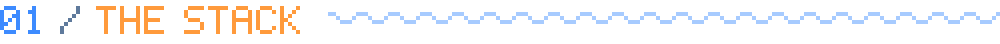
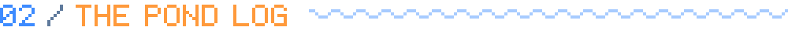
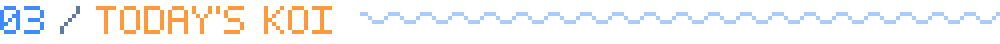
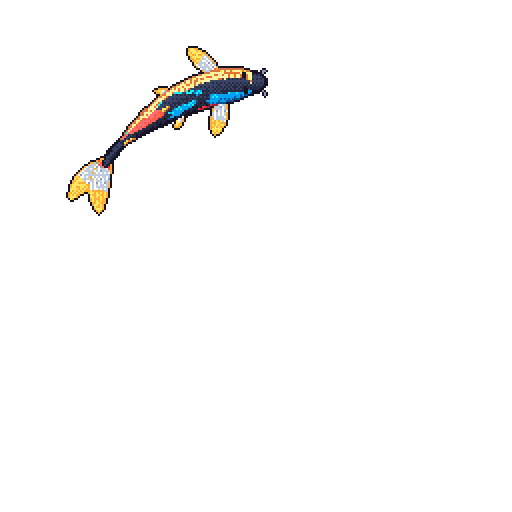

  

  
  &nbsp;
  

 

  

 

  <b>THE SURFACE</b>&nbsp; · &nbsp;what you see
    
  

  <b>THE SHALLOWS</b>&nbsp; · &nbsp;what fits in your pocket
    
  

  <b>THE DEPTHS</b>&nbsp; · &nbsp;what keeps it afloat
    
  

  <b>THE TACKLE BOX</b>&nbsp; · &nbsp;what I reach for
    
  

 

  
  
   
  

 

  
   
  a new koi is drawn into this pond every night at 03:20 nairobi time by <a href="https://github.com/yalongwastaken/git-koi">git-koi</a>

 

  

<!-- artwork in /assets is generated by assets/build.mjs — edit it there and run: node assets/build.mjs -->
