  

<h2 align="center">Hi, I'm Nathan</h2>

  <picture>
    <source media="(prefers-color-scheme: dark)" srcset="assets/tagline-dark.svg">
    
  </picture>

 

<h3 align="center">connect</h3>

  
  

 

<h3 align="center">stack</h3>

  

 

<h3 align="center">activity</h3>

  
  

 

  

